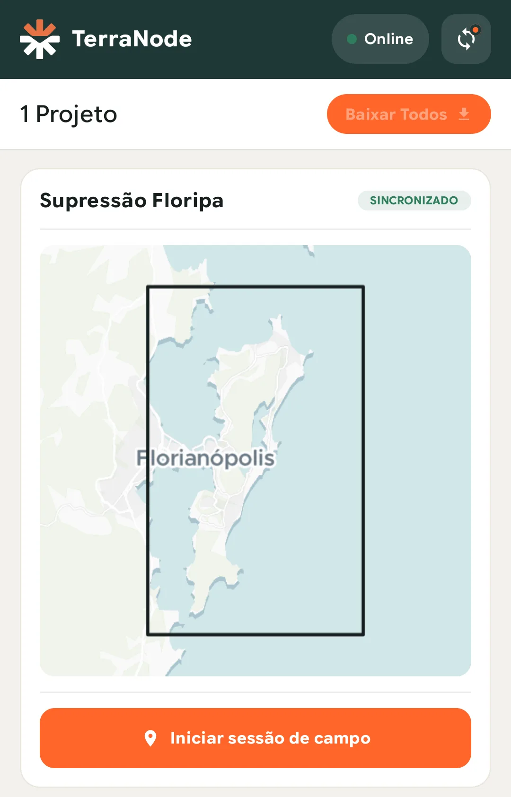
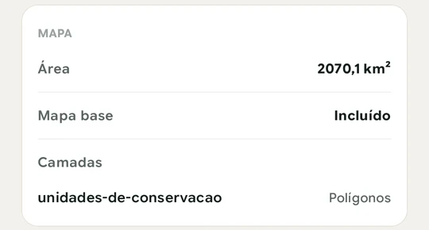
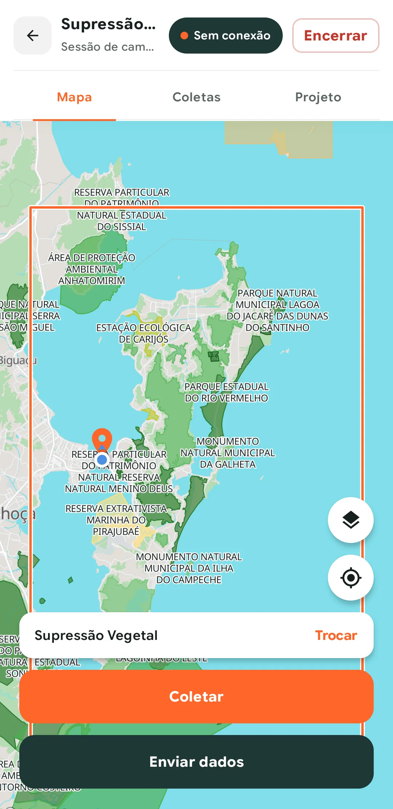
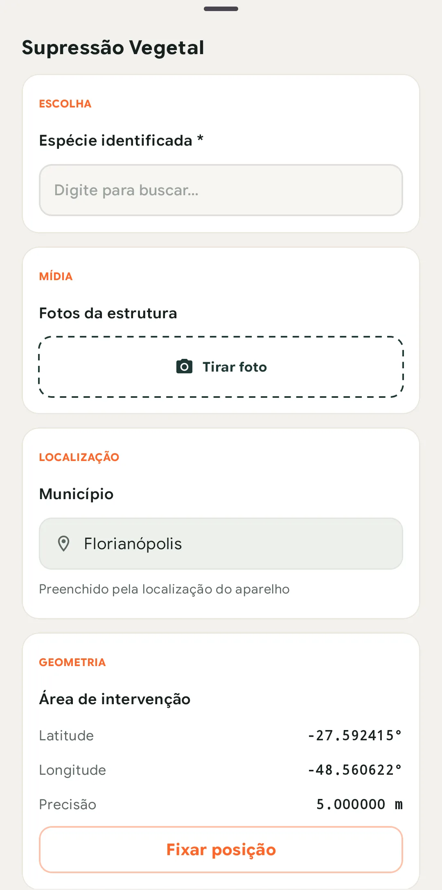
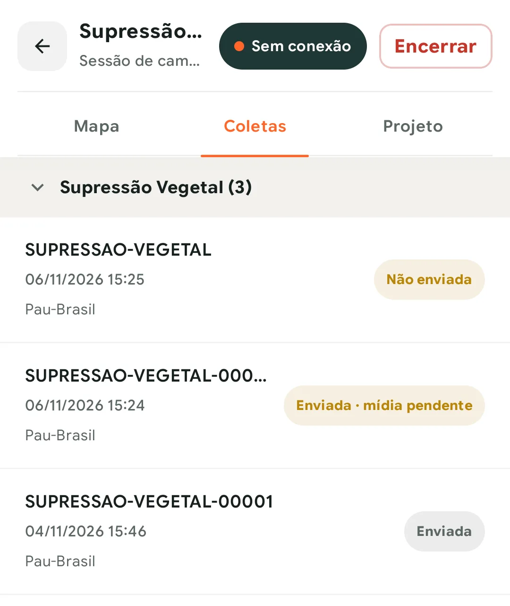

Sem sinal, quase nada se resolve no campo. Se você não baixou o mapa ou não aceitou a permissão de localização, o dia de trabalho para ali. Por isso este guia começa no escritório, com internet, e só depois vai para a coleta.

> O TerraNode está em beta fechado, e o app roda em Android 12 ou mais recente. Se a sua equipe ainda não tem acesso, [entre na lista de espera](https://form.typeform.com/to/ZVQYTFV5).

## Antes de sair, deixe tudo no aparelho

Faça estes passos com internet, porque o app precisa de conexão para entrar na conta e baixar o projeto.

1. Instale o app e entre com o mesmo e-mail e senha do painel web.
2. Na aba **Projetos**, toque em **Baixar projeto**. Pode fechar o app, porque o download continua em segundo plano. Se a conexão cair, ele baixa depois só os arquivos que faltam.
3. Espere o cartão do projeto mostrar **Sincronizado**. Nesse estado, o mapa, as camadas e os seus formulários já estão no aparelho.
4. Abra o projeto e confira as camadas. Em **Camadas**, procure as que você vai usar. Na aba **Projeto**, o mapa base deve aparecer como **Incluído**. Sem ele, as camadas ficam sobre um fundo vazio quando não há sinal.
5. Confira se há espaço livre. As fotos ficam em resolução original, sem compressão, e o app não inicia uma gravação de vídeo ou áudio se faltar espaço para a duração máxima.

*O cartão do projeto depois do download.*

*A seção Mapa da aba Projeto, com o mapa base incluído.*

Dois avisos pedem ajuda de quem gerencia o projeto. **Sem pacote disponível** significa que o projeto ainda não tem área de cobertura ou que o TerraNode ainda está gerando o pacote. "Nenhum formulário atribuído a você neste projeto", no botão **Coletar** desativado, significa que falta incluir você em um formulário. Resolva os dois antes de sair.

## No campo, abra uma sessão

Toque em **Iniciar sessão de campo** no cartão do projeto. Na primeira vez, o Android pede a localização precisa, e sem ela a sessão não inicia.

A sessão agrupa as coletas daquela saída e registra o seu trajeto. Mesmo com a tela desligada, o app grava uma posição a cada 60 segundos e ignora leituras com precisão pior que 50 m. Fora de uma sessão, nenhuma posição sai do aparelho.

*O projeto em modo avião. O mapa, as camadas e o botão Coletar continuam funcionando.*

## Colete cada ponto

1. Na aba **Mapa**, toque em **Coletar**. Se você tem mais de um formulário no projeto, escolha um. O app guarda a escolha, e **Trocar** muda de formulário depois.
2. Preencha os campos. Os obrigatórios têm asterisco, e os condicionais aparecem ou somem conforme as respostas.
3. Olhe o campo de geometria, se o formulário tiver um. Ele mostra latitude, longitude e a precisão do GPS, e **Fixar posição** trava o ponto. Quando esse campo é obrigatório, o envio espera até haver sinal de GPS.
4. Tire as fotos pelo próprio formulário, em **Tirar foto**. Cada foto guarda a melhor posição dos 30 segundos antes do clique.
5. Toque em **Enviar**.

*Um formulário aberto em campo. O Município já veio preenchido pela localização.*

O nome do botão engana um pouco. Sem sinal, **Enviar** grava a coleta no aparelho, cria um pino no mapa e coloca uma linha na aba **Coletas** com o estado **Não enviada**. A coleta sobe depois, quando houver conexão.

Hoje o app coleta apenas pontos. Linhas e polígonos aparecem no mapa como camadas de referência, mas um campo de formulário que aceite só linha ou polígono ainda não funciona no app.

## Quando o sinal voltar

As respostas e as mídias sobem em momentos diferentes. Com isso, quem gerencia acompanha o avanço assim que há conexão, e você decide quando gastar a rede com arquivos pesados.

| O quê | Quando sobe |
| --- | --- |
| Respostas dos formulários | Sozinhas, com conexão: ao gravar uma coleta, ao encerrar a sessão, ao abrir o app e a cada 10 minutos com a sessão aberta |
| Trajeto | Sozinho, com conexão: a cada coleta enviada e a cada 10 minutos |
| Fotos, vídeos, áudios e assinaturas | Só quando alguém toca em **Enviar dados** |

O botão **Enviar dados** aparece no mapa do projeto e no cartão dele. Se puder, use-o em um Wi-Fi ao fim do dia. Se a conexão cair no meio de um arquivo, o envio retoma de onde parou. Sem conexão, o botão mostra **Aguardando conexão** e começa sozinho quando a internet volta.

Na aba **Coletas**, o estado de cada linha diz o que falta:

| Estado | O que significa |
| --- | --- |
| **Não enviada** | A resposta ainda está só no aparelho |
| **Enviada · mídia pendente** | A resposta chegou, mas as fotos ainda estão só no aparelho |
| **Enviada** | A resposta e todas as mídias chegaram e foram verificadas |
| **Recusada** | O servidor recusou, e o motivo aparece dentro da coleta |

*A coleta só ganha número depois que a resposta chega ao servidor, por isso a primeira linha ainda não tem um.*

## Encerre a sessão

Ao terminar, toque em **Encerrar**. Depois disso, você não consegue mais editar nem excluir as coletas da sessão no app, e não há como reabri-la. Para coletar de novo, inicie outra sessão. O botão **Enviar dados** continua funcionando depois de encerrar.

## O que evitar

- **Desinstalar o app com coletas pendentes.** Desinstalar apaga as coletas que ainda não subiram. Se o app desconectar a sua conta, entre de novo com a mesma conta, porque os dados continuam no aparelho.
- **Fechar o formulário sem tocar em Enviar.** Isso descarta tudo o que você preencheu, inclusive as fotos e as gravações.
- **Ler "Enviada · mídia pendente" como trabalho terminado.** As fotos desse registro só existem no celular até alguém tocar em **Enviar dados**.

## Próximos passos

Se a equipe trabalha sobre limites, redes ou lotes que já existem, veja [como levar um Shapefile para o campo](/blog/como-levar-um-shapefile-para-o-campo/). Para conhecer o resto do app, veja a [página do aplicativo](/recursos/aplicativo/). E para montar o que a equipe preenche, comece pelo [construtor de formulários](/recursos/formularios/).
