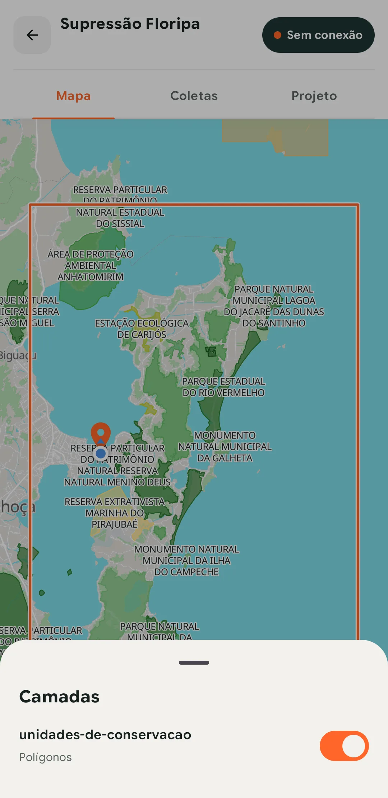
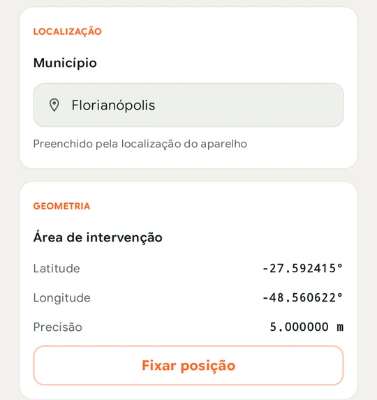

Um Shapefile nunca é um arquivo só. São pelo menos o `.shp`, o `.shx` e o `.dbf`, quase sempre com um `.prj` para a projeção. Copiar essa pasta para o celular não basta, porque falta o mapa de fundo, a área de trabalho, o estilo e um jeito de coletar por cima.

No TerraNode, o Shapefile vira uma camada do projeto. Você envia o arquivo para um catálogo e escolhe a camada em um projeto. O TerraNode gera um pacote offline, e a equipe baixa esse pacote no app.

> O TerraNode está em beta fechado, e o app roda em Android 12 ou mais recente. Se a sua equipe ainda não tem acesso, [entre na lista de espera](https://form.typeform.com/to/ZVQYTFV5).

## 1. Prepare o arquivo

Compacte o Shapefile em um `.zip`. O TerraNode recusa o `.shp` solto com a mensagem **Tipo de arquivo não suportado**. Um mesmo `.zip` pode levar vários Shapefiles, e cada um vira uma camada separada.

Antes de compactar, confira:

- **Sistema de referência.** O arquivo precisa declarar um sistema ligado à Terra, então inclua o `.prj`. Sistemas locais ou de engenharia fazem a camada falhar. O TerraNode converte os dados para WGS84, então você não precisa reprojetar antes.
- **Acentos.** Sem codificação declarada, o TerraNode lê o texto como UTF-8 e, se não for válido, como ISO-8859-1. Se os acentos chegarem errados, confira a codificação do arquivo.
- **Nomes de coluna.** Eles ficam em minúsculas, com apóstrofo, hífen e `#` trocados por `_`. Uma coluna chamada `geometry` dá erro e precisa ser renomeada.
- **Tamanho.** O limite é de 2 GB por arquivo e 128 camadas por envio.

## 2. Envie para um catálogo

O catálogo é onde a organização guarda os dados geográficos. Você importa uma vez e usa a mesma camada em quantos projetos precisar. Enviar arquivos pede o papel de Gestor ou Editor.

1. Em **Catálogos**, escolha **Novo catálogo** e dê um nome.
2. Na página do catálogo, escolha **Enviar dados** e arraste o `.zip`.
3. Confirme e acompanhe cada camada passar por **Na fila**, **Processando** e **Concluído**.

<!-- PRINT PENDENTE: janela "Enviar dados para o catálogo", com as camadas do .zip em processamento. -->

Pode fechar a janela, porque o processamento continua no servidor. O TerraNode processa cada camada separadamente, então um Shapefile com problema não impede os outros de entrarem. Se algum falhar, corrija e envie só esse.

## 3. Ajuste a aparência, se quiser

Uma camada sem estilo já aparece no mapa, com a aparência padrão. Para colorir por categoria ou criar classes, use a aba **Estilos** do catálogo e clique em **Salvar estilo**. O projeto herda esse estilo, e o app recebe o mesmo mapa. A [página de Catálogos](/recursos/catalogos/) mostra as opções.

## 4. Crie o projeto e escolha a camada

Em **Projetos**, escolha **Novo projeto** e siga o assistente. Dois passos importam mais aqui:

- **Área de cobertura.** Desenhe no mapa ou envie um arquivo. O passo seguinte só oferece catálogos com dados que cruzam essa área, e o pacote recorta as camadas por ela. O que ficar fora da área não vai para o celular. Um polígono em Shapefile também serve como área, desde que o `.zip` tenha exatamente um `.shp` e no máximo 10 MB.
- **Camadas.** Escolha **Adicionar**, encontre o catálogo em **Buscar catálogo**, marque a camada e escolha **Concluir**. Na lista, a camada de cima é desenhada por cima das outras.

<!-- PRINT PENDENTE: assistente "Novo projeto" no passo Camadas, com a camada do Shapefile na lista. -->

Nos passos **Equipe** e **Formulários**, adicione as pessoas e os formulários. Para cada formulário, **Selecionar coletores** diz quem o recebe no app. Sem isso, o coletor abre o mapa, mas não consegue coletar. Termine em **Criar projeto**.

## 5. Espere o pacote ficar pronto

O TerraNode gera o pacote offline sem você precisar publicar nada, cerca de dois minutos depois da última mudança. A aba **Pacotes** do projeto mostra o andamento e o tamanho do download. A versão pronta aparece em **Disponível para o campo**.

<!-- PRINT PENDENTE: aba Pacotes do projeto, com uma versão em "Disponível para o campo" e o tamanho do download. -->

Cuidado se você criou o projeto logo depois do envio. A camada vetorial já pode entrar no projeto, mas o mapa dela fica pronto um pouco depois, e até lá ela fica fora do pacote. O teste do próximo passo pega esse caso.

Agrupe as alterações, porque cada versão nova do pacote pede uma atualização no celular de cada pessoa. Se o download ficou grande, reduza a área de cobertura ou tire camadas raster.

## 6. Baixe no celular e teste sem internet

1. No app, na aba **Projetos**, toque em **Baixar projeto** e espere o cartão mostrar **Sincronizado**.
2. Coloque o celular em modo avião e abra o projeto.
3. Toque em **Camadas** e confira se a sua camada está na lista, com o tipo de geometria certo.

*O teste em modo avião. A camada aparece na lista e no mapa, e o aviso no topo confirma que não há conexão.*

Se ela aparece em modo avião, vai aparecer no campo. Se não aparece, volte à aba **Pacotes** e veja se saiu uma versão mais nova. Quando sair, o cartão no celular muda para **Atualização pendente**, e **Atualizar Projeto** baixa só os arquivos que mudaram.

No app, a camada serve de referência. O coletor liga e desliga a camada no mapa e coleta por cima, e cada coleta gera um registro novo. As feições do seu Shapefile continuam como estão.

## 7. Faça o Shapefile preencher o formulário

Com uma camada de polígonos no catálogo, como talhões, bairros ou lotes, o formulário pode preencher um campo sozinho a partir da posição da coleta.

No construtor de formulários, adicione um campo **Consulta por localização**. Escolha a **Fonte de dados**, que é a sua camada de polígonos, e a **Coluna** que deve ser copiada. O formulário também precisa de um campo de geometria. A camada nem precisa estar entre as do projeto, porque o pacote já leva a fonte que o campo lê.

Em campo, o app calcula o valor no próprio aparelho, a partir do pacote, sem internet. Ninguém precisa digitar o nome do talhão nem escolher em uma lista. Se o app não encontrar valor para aquela posição, o servidor calcula quando receber a coleta.

*O coletor não edita esse campo. O município veio de uma fonte de polígonos, a partir do ponto mostrado logo abaixo.*

## Se algo der errado

| O que você vê | O que fazer |
| --- | --- |
| **Tipo de arquivo não suportado** | Compacte o Shapefile em um `.zip` |
| "vector source must use an earth-referenced CRS" | O arquivo não declara sistema de referência ou usa um sistema local. Defina o sistema antes de enviar |
| "no supported datasets found in upload" | O `.zip` não tem nenhum arquivo reconhecido ou está corrompido. Monte o `.zip` de novo |
| "a column named geometry conflicts..." | Renomeie a coluna `geometry` e envie de novo |
| **Sem pacote disponível**, no app | O projeto não tem área de cobertura ou o pacote ainda está sendo gerado. Veja a aba **Pacotes** |

## Próximos passos

Com a camada no aparelho, siga para [como coletar dados em campo sem internet](/blog/como-coletar-dados-em-campo-sem-internet/). Se os seus dados estão no ArcGIS, veja as [integrações](/recursos/integracoes/), que trazem as camadas sem precisar enviar arquivos.
