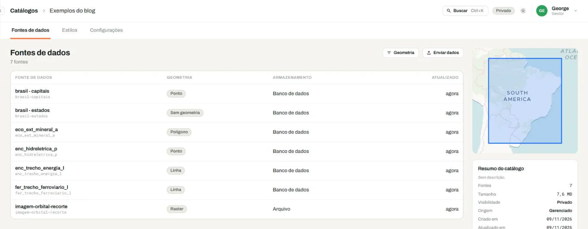

Uma pasta de projeto raramente chega arrumada. A deste exemplo tem quatro Shapefiles do IBGE em uma subpasta, uma planilha com duas abas, uma imagem de satélite e um PDF de metadados. Antes de levar esse material para o campo, alguém precisa descobrir o que serve, conferir os sistemas de referência e fazer tudo aparecer no mesmo mapa.

A pasta entra no TerraNode como um único `.zip` e termina como sete fontes de dados no catálogo: quatro camadas do IBGE, duas abas da planilha e um raster. No caminho, ele abre o pacote, encontra as camadas, procura coordenadas nas planilhas e prepara cada fonte separadamente.

> O TerraNode está em beta fechado, e o app roda em Android 12 ou mais recente. Se a sua equipe ainda não tem acesso, [entre na lista de espera](https://form.typeform.com/to/ZVQYTFV5).

## O TerraNode abre a pasta inteira

Você compacta a pasta como ela está, sem tirar os arquivos das subpastas. O TerraNode percorre a estrutura inteira e separa o que sabe ler. No nosso exemplo, encontra os quatro Shapefiles, a planilha e o GeoTIFF. O PDF não é um dado geográfico e fica de fora.

Além desses formatos, ele lê GeoPackage, GeoJSON, FlatGeobuf, MapInfo, File Geodatabase, CSV, planilhas do LibreOffice e ERDAS Imagine. Uma pasta `.gdb` conta como um conjunto de dados só, do mesmo jeito que o ArcGIS a trata.

Um mesmo arquivo pode gerar várias [fontes de dados](https://docs.terranode.com.br/catalogos/#fontes-de-dados), uma para cada camada vetorial, tabela, aba de planilha ou raster. As duas abas da planilha do exemplo geram duas fontes, e um GeoPackage com doze tabelas gera doze. Se uma fonte falha no processamento, as demais continuam, e o envio inteiro só falha quando não dá para ler nada do pacote.

*O `.zip` do exemplo e as sete fontes que saem dele.*

O `.zip` também mantém juntos os formatos feitos de vários arquivos. Shapefile, MapInfo e File Geodatabase precisam ser [compactados antes do envio](https://docs.terranode.com.br/catalogos/importar-dados/#formatos-aceitos). Um `.shp` solto, sem os arquivos que o completam, é recusado com a mensagem **Tipo de arquivo não suportado**. GeoPackage, GeoJSON, FlatGeobuf, CSV, planilhas e rasters podem ir soltos ou compactados.

## As duas abas seguem caminhos diferentes

A primeira aba da planilha traz as capitais do Brasil, com colunas de latitude e longitude. A segunda traz os estados e não tem coordenadas.

Em `.xlsx` e `.ods`, cada aba vira uma fonte separada, sempre com a primeira linha como cabeçalho. O TerraNode ignora uma aba vazia ou só com o cabeçalho. Nas outras, ele procura colunas de coordenadas sem ligar para acentos e maiúsculas, e reconhece o nome mesmo com texto antes ou depois. Por isso, "Latitude (WGS84)" e "Posição Lng" funcionam. Uma coordenada digitada com vírgula decimal, como `-46,5`, também vira número.

Na aba das capitais, cada linha com um par válido vira um ponto em WGS84. Se uma linha tiver a coordenada vazia, um texto como `n/d` ou um valor impossível, como latitude 200, só aquela linha fica sem ponto.

No CSV, a busca é mais rígida. As colunas precisam se chamar exatamente `longitude`, `lon`, `long`, `lng` ou `x`, e `latitude`, `lat` ou `y`, com maiúsculas ou minúsculas. Se a planilha usa nomes como "Lat. (graus)", é melhor enviar o `.xlsx` em vez de exportar um CSV.

A aba dos estados, sem coordenadas, entra como uma fonte **Sem geometria**. Ela não aparece no mapa, mas mantém a tabela de atributos e pode servir de base para um formulário. O Excel antigo, no formato `.xls`, fica de fora. Antes do envio, abra o arquivo no Excel ou no LibreOffice e salve como `.xlsx`.

Se a planilha mora no Google Sheets, a [integração](https://docs.terranode.com.br/integracoes/google-sheets/) traz as abas direto, sem baixar arquivo, com o mesmo detector de coordenadas. Ali o TerraNode lê também o tipo de cada célula, então datas continuam datas e números continuam números. Se ele escolher a coluna errada, você indica qual é a latitude e qual é a longitude.

*O catálogo depois do envio. A aba dos estados aparece como Sem geometria.*

## Cada fonte é preparada para o mapa

Depois de separar as sete fontes, o TerraNode prepara cada uma para que as camadas se sobreponham corretamente no mapa e no celular.

Primeiro vem o sistema de referência. Todo vetor e todo raster precisa declarar um sistema ligado à Terra, como SIRGAS 2000 em UTM, SAD69 ou WGS84. O TerraNode converte os vetores para WGS84, sem exigir reprojeção antes do envio. Mas ele não consegue descobrir um sistema que o arquivo não declarou. Um Shapefile sem o `.prj` falha, assim como um arquivo em um sistema local de engenharia sem referência à Terra.

Depois vem a limpeza dos vetores. O TerraNode corrige geometrias inválidas, como um polígono que cruza a si mesmo, e converte pontos, linhas e polígonos para o tipo "multi", que aceita várias partes na mesma feição. Valores de altitude Z e medidas M ficam de fora, e a camada entra em duas dimensões. Os nomes das colunas ficam em minúsculas, com apóstrofo, hífen e `#` trocados por `_`, e mantêm acentos e espaços.

Nos Shapefiles, os acentos dentro dos dados dependem da codificação do texto, e muitos arquivos gerados no Brasil não declaram nenhuma. Nesse caso, o TerraNode tenta ler como UTF-8 e, se não der, tenta de novo como ISO-8859-1, a codificação que boa parte dos programas antigos usava.

O GeoTIFF segue outro caminho. Ele fica guardado como Cloud Optimized GeoTIFF, sem perda de qualidade, em um formato que o mapa carrega por partes. As estatísticas de cada banda saem do arquivo inteiro, e não de uma amostra. Na primeira abertura, uma imagem RGB aparece em cor verdadeira, enquanto um raster de elevação recebe uma rampa entre o mínimo e o máximo.

<!-- lista-de-espera -->

## Três decisões continuam com quem envia

O processamento automatiza boa parte do trabalho, mas não corrige informação que nunca chegou ao arquivo. Quem envia ainda precisa garantir três coisas: incluir o `.prj` no pacote do Shapefile, compactar formatos compostos por vários arquivos e usar nomes de coluna reconhecíveis para as coordenadas, principalmente em CSV.

A pasta misturada do começo agora são sete fontes no catálogo. As capitais estão no mapa, os estados ficaram como tabela e os quatro Shapefiles se sobrepõem ao GeoTIFF. Cada fonte pode receber um estilo e seguir para um projeto de campo.

A lista completa de formatos, os limites de tamanho e os erros mais comuns estão na [documentação de importação](https://docs.terranode.com.br/catalogos/importar-dados/). Para acompanhar uma dessas camadas até o celular, leia [como levar um Shapefile para o campo](/blog/como-levar-um-shapefile-para-o-campo/). Se os dados já estão no ArcGIS ou no Google Sheets, as [integrações](/recursos/integracoes/) evitam o envio manual de arquivos.
