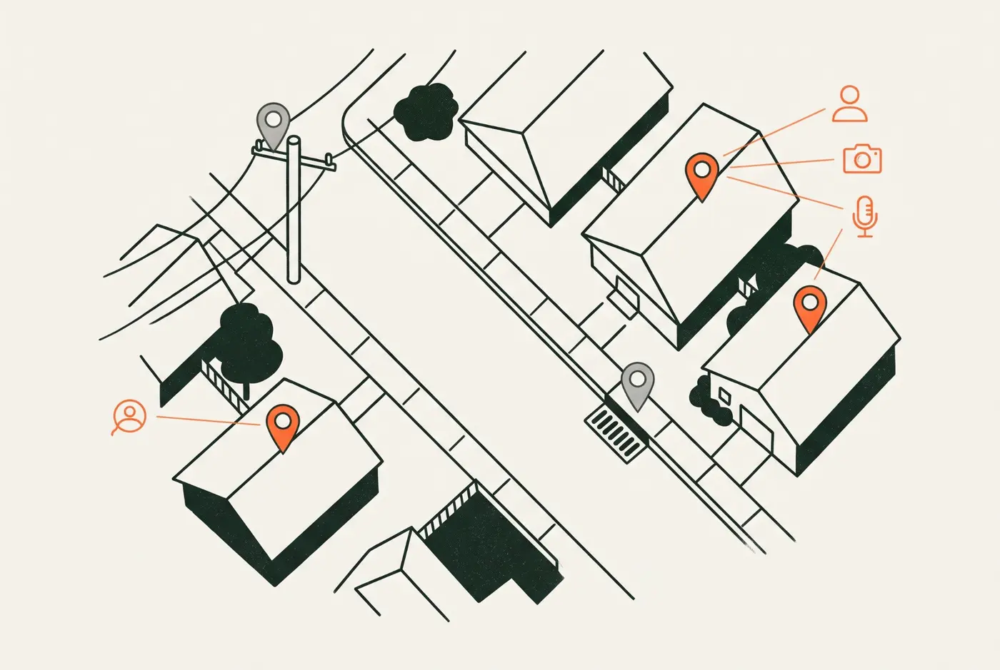
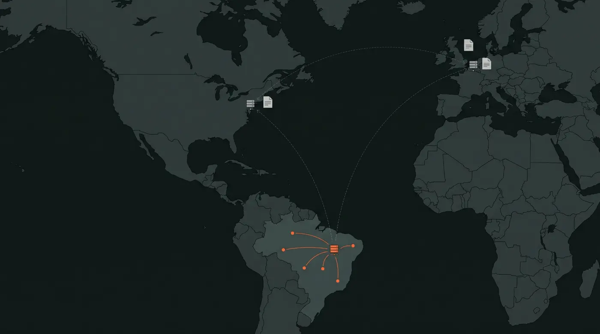
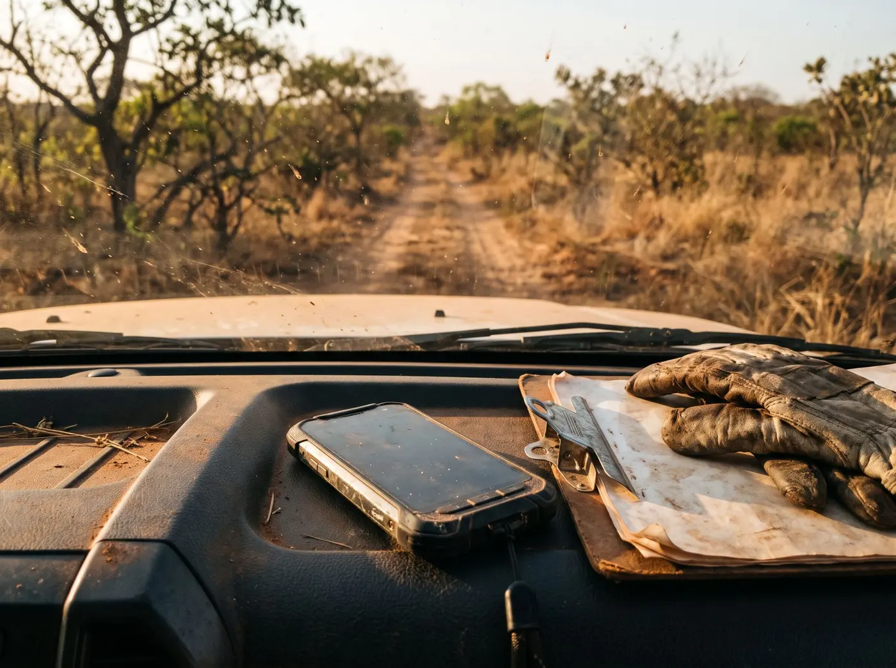

Um técnico volta do campo com 300 pontos, 900 fotos e uma dúzia de áudios no celular. No meio disso há nomes de moradores, fachadas de casas, placas de carro e a coordenada exata de onde cada pessoa mora. Tudo isso é dado pessoal, e a LGPD vale para ele do mesmo jeito que vale para um cadastro de clientes.

A resposta curta para a pergunta do título: a LGPD não obriga ninguém a guardar dados no Brasil. Mas quando o dado sai do país, a lei cobra garantias e documentos que quase nenhuma equipe de campo tem em ordem. Manter tudo em território nacional é o caminho mais simples para não precisar deles.

## O que vira dado pessoal numa coleta de campo

Para a LGPD, dado pessoal é qualquer informação relacionada a uma pessoa natural identificada ou identificável. O [guia da ANPD para o cidadão](https://www.gov.br/anpd/pt-br/documentos-e-publicacoes/documentos-de-publicacoes/guia-do-consumidor_como-proteger-seus-dados-pessoais-final.pdf) cita a geolocalização de um celular entre os exemplos.

A coordenada de um poste não é dado pessoal. A coordenada de uma casa, ligada ao nome de quem mora nela, é. Em campo essa ligação acontece o tempo todo:

| O que se coleta | Por que entra na LGPD |
| --- | --- |
| Nome, telefone ou CPF no formulário | Identifica a pessoa diretamente |
| Ponto de uma residência ou propriedade | Mostra onde uma pessoa identificável mora |
| Foto de fachada, rosto ou placa de carro | A imagem permite identificar alguém |
| Áudio de entrevista com morador | Voz e conteúdo ligados a uma pessoa |
| Cadastro de imóvel com proprietário | Une endereço, pessoa e patrimônio |
| Trajeto do coletor durante o dia | É dado pessoal do próprio funcionário |

Há um degrau acima. Cadastros socioeconômicos de licenciamento ou de regularização fundiária costumam perguntar sobre saúde, religião ou origem étnica. Esses são dados pessoais sensíveis, e a lei é mais rígida com eles.

## A LGPD obriga a guardar os dados no Brasil?

Não. A lei vale para dados de pessoas no Brasil esteja o servidor onde estiver, e o artigo 33 permite levar dados para fora em hipóteses específicas. O que ela exige é que você saiba para onde o dado vai e consiga sustentar isso no papel.

Esse papel ficou mais concreto nos últimos dois anos:

- Em agosto de 2024 a ANPD publicou a [Resolução 19](https://www.demarest.com.br/anpd-aprova-o-regulamento-de-transferencia-internacional-de-dados/), com o regulamento de transferência internacional e o texto das cláusulas padrão contratuais.
- O prazo de adaptação [terminou em 23 de agosto de 2025](https://www.mayerbrown.com/pt/insights/publications/2025/08/end-of-grace-period-implementation-of-brazils-standard-contractual-clauses-in-international-transfers-of-personal-data). Desde então, quem manda dado pessoal para um fornecedor no exterior precisa das cláusulas no contrato ou de outro mecanismo aceito.
- Em janeiro de 2026 a ANPD [reconheceu a União Europeia](https://www.globalsuitesolutions.com/pt/?p=117782) como destino com proteção adequada. Para os demais países, Estados Unidos incluídos, o caminho usual continua sendo as cláusulas.

Na prática, se o app de coleta guarda os registros num servidor fora do país, quem contratou o app está fazendo uma transferência internacional. Precisa saber disso, ter o contrato certo e conseguir explicar para o titular e para a ANPD.

Quando o dado nasce, trafega e fica no Brasil, sem nenhum agente de tratamento no exterior, não existe transferência para justificar. É uma pilha de documentos a menos.

Um cuidado: "servidor no Brasil" não resolve tudo sozinho. Vale perguntar ao fornecedor onde ficam os backups e quais terceiros tocam no dado.

## O celular que ficou no mato

A LGPD pede medidas técnicas e administrativas para proteger dados pessoais de acesso não autorizado e de perda. Em campo, o risco mais comum não é um ataque sofisticado. É o aparelho esquecido na caminhonete, o cartão de memória emprestado, a planilha enviada por mensagem.

Se um celular com cadastro de moradores some e os arquivos estão abertos, isso é um incidente de segurança. Quando há risco relevante para as pessoas, a [Resolução 15 da ANPD](https://www.serpro.gov.br/menu/noticias/noticias-2025/incidentes-seguranca-dados-pessoais) dá três dias úteis para comunicar a autoridade e os titulares, com mais vinte dias úteis para completar as informações. Para agentes de pequeno porte os prazos [contam em dobro](https://confidata.com.br/blog/comunicacao-incidente-seguranca-anpd).

Três dias úteis é pouco para quem precisa primeiro descobrir o que havia no aparelho. Com o dado criptografado no dispositivo, a conversa muda: quem achou o celular não consegue ler nada.

A conta de não cuidar é alta. A multa simples do [artigo 52](https://confidata.com.br/blog/lgpd-comentada-25-sancoes-administrativas) vai até 2% do faturamento no Brasil, limitada a R$ 50 milhões por infração. E as falhas que a ANPD mais puniu até aqui são justamente [não comunicar incidente e ter segurança inadequada](https://turivius.com/portal/multas-da-lgpd/).

## Como o TerraNode trata cada ponto

O TerraNode foi desenhado para equipes que coletam onde o sinal não chega, e a proteção do dado entrou na arquitetura desde o início. Cada ponto da lei tem um par no produto:

| O que a lei pede | O que acontece em campo | Como o TerraNode responde |
| --- | --- | --- |
| Saber onde o dado fica | Apps guardam registros em servidores fora do país sem avisar | Dados armazenados no Brasil |
| Proteger o dado no aparelho | Celular perdido com fotos e formulários abertos | Tudo que é coletado fica criptografado no dispositivo, inclusive offline |
| Proteger o dado no caminho | Arquivos enviados por mensagem ou planilha | Criptografia nos dois sentidos, do escritório ao campo e de volta |
| Limitar quem acessa | Todo mundo vê tudo | Perfis de coletor, revisor e gestor, com formulários atribuídos por pessoa |
| Coletar só o necessário | Campo livre onde cabe qualquer coisa | Formulários com campos e regras definidos antes da saída |
| Garantir a qualidade | Dado errado segue para o cliente | Fila de revisão: só o registro validado sai |
| Manter o controle com quem coletou | Dado preso na ferramenta | Os dados são da organização e saem a qualquer momento em CSV, GeoJSON ou Shapefile |
| Não espalhar credenciais | Senha do portal GIS compartilhada | Conexão com ArcGIS por OAuth ou chave de API, somente leitura, sem pedir a senha |

Nenhuma ferramenta deixa uma empresa em conformidade sozinha. Definir a base legal da coleta, avisar as pessoas e decidir por quanto tempo guardar continuam sendo tarefas de quem é dono do projeto. O que o TerraNode faz é tirar da frente a parte que depende de tecnologia. A [página de segurança](/recursos/seguranca/) detalha cada uma dessas camadas.

<!-- lista-de-espera -->

## Sete perguntas antes de sair para o campo

1. O formulário pede algum dado pessoal que o projeto não precisa?
2. Há dado sensível, como saúde, religião ou origem étnica? Ele é mesmo indispensável?
3. As fotos precisam mostrar rostos e placas, ou dá para enquadrar sem eles?
4. Em que país ficam os servidores e os backups do app de coleta?
5. Se o celular sumir hoje, alguém consegue abrir os arquivos?
6. Quem na equipe enxerga o quê? O coletor precisa ver os registros dos outros?
7. Quem avisa a ANPD e em quanto tempo, se algo der errado?

## Perguntas frequentes

**Coordenada geográfica é dado pessoal?** Depende do que ela aponta. A posição de um bueiro não é. A posição de uma casa ligada a um morador identificável é, assim como o trajeto de um funcionário.

**Posso usar um app de coleta com servidor fora do Brasil?** Pode. A LGPD não proíbe. Mas isso é uma transferência internacional e pede um dos mecanismos do artigo 33, em geral as cláusulas padrão da ANPD no contrato.

**Foto de fachada entra na LGPD?** Entra quando permite identificar alguém, pelo rosto, pela placa do carro ou pela ligação com o cadastro do imóvel.

**Quem responde pelo dado: a empresa que coleta ou o fornecedor do app?** Em geral, quem decide o que coletar e para quê é o controlador, e o fornecedor do app atua como operador. Os dois têm deveres de segurança, mas as decisões e a relação com o titular são do controlador.

**Guardar os dados no Brasil garante conformidade?** Não garante. Elimina a parte de transferência internacional e facilita a fiscalização, mas base legal, segurança e direitos dos titulares continuam valendo.

## Fontes

- [Guia da ANPD: como proteger seus dados pessoais](https://www.gov.br/anpd/pt-br/documentos-e-publicacoes/documentos-de-publicacoes/guia-do-consumidor_como-proteger-seus-dados-pessoais-final.pdf)
- [Demarest: ANPD aprova o Regulamento de Transferência Internacional de Dados](https://www.demarest.com.br/anpd-aprova-o-regulamento-de-transferencia-internacional-de-dados/)
- [Mayer Brown: fim do período de adaptação da Resolução 19](https://www.mayerbrown.com/pt/insights/publications/2025/08/end-of-grace-period-implementation-of-brazils-standard-contractual-clauses-in-international-transfers-of-personal-data)
- [GlobalSuite: transferência internacional na LGPD e decisão sobre a União Europeia](https://www.globalsuitesolutions.com/pt/?p=117782)
- [Locaweb: LGPD e cloud, onde os dados precisam estar](https://www.locaweb.com.br/blog/temas/seguranca-digital/lgpd-cloud-computing-onde-dados-precisam-estar/)
- [Serpro: comunicação de incidentes de segurança](https://www.serpro.gov.br/menu/noticias/noticias-2025/incidentes-seguranca-dados-pessoais)
- [Confidata: comunicação de incidente à ANPD](https://confidata.com.br/blog/comunicacao-incidente-seguranca-anpd)
- [Confidata: sanções administrativas do artigo 52](https://confidata.com.br/blog/lgpd-comentada-25-sancoes-administrativas)
- [Turivius: multas da LGPD em 2026](https://turivius.com/portal/multas-da-lgpd/)
