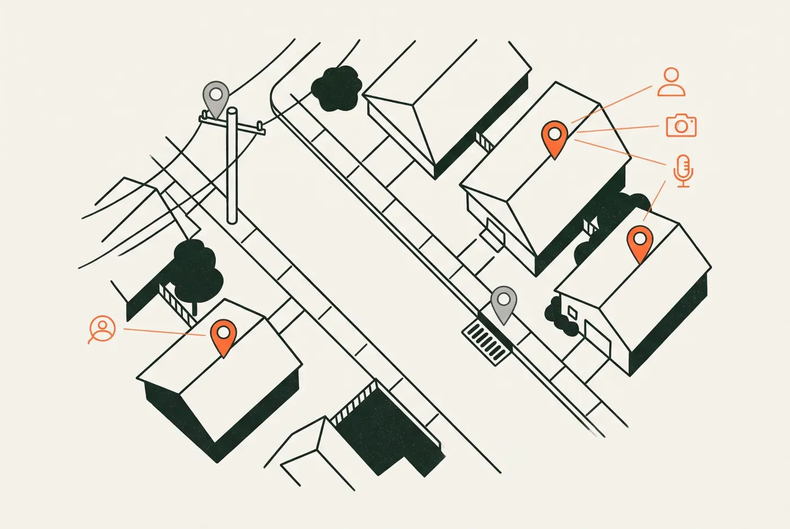
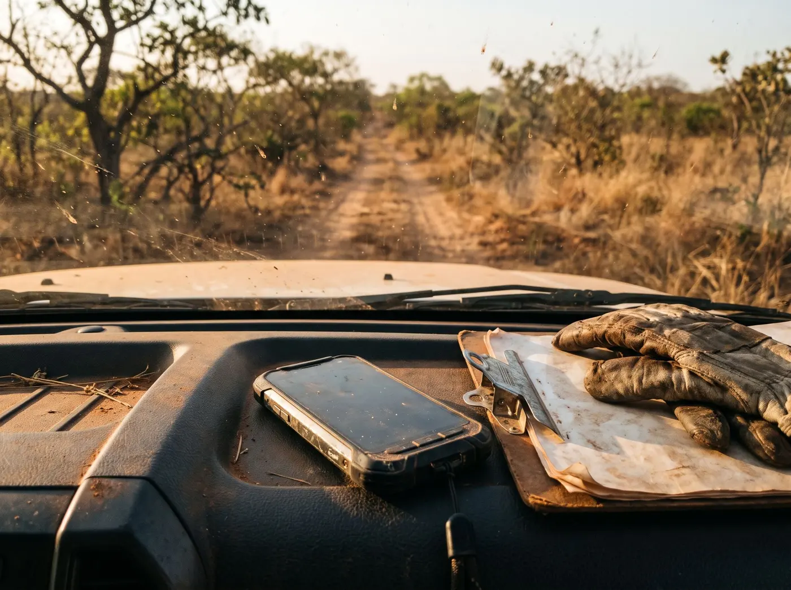
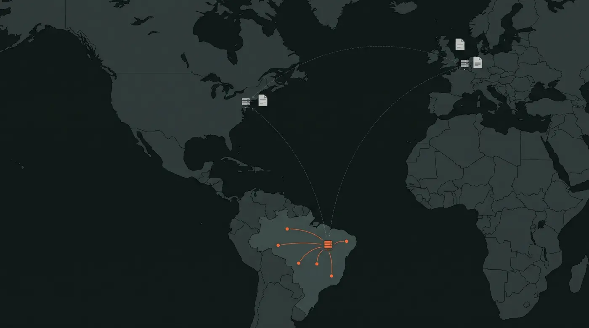

Um técnico volta do campo com 300 pontos, 900 fotos e uma dúzia de áudios no celular. Entre esses arquivos há nomes de moradores, fachadas de casas, placas de carro e coordenadas de residências. A campanha acabou para a equipe de campo, e a empresa agora responde por tudo o que está naquele celular.

A LGPD acompanha o dado durante todo o percurso. Ela vale quando a empresa decide o que perguntar, enquanto o registro está no celular e depois que ele chega ao servidor. A lei não obriga a guardar os dados no Brasil, mas quem guarda aqui evita a transferência internacional e os documentos que ela exige.

## Antes da saída, decida o que realmente precisa ser coletado

Para a LGPD, dado pessoal é qualquer informação relacionada a uma pessoa natural identificada ou identificável. O [guia da ANPD para o cidadão](https://www.gov.br/anpd/pt-br/documentos-e-publicacoes/documentos-de-publicacoes/guia-do-consumidor_como-proteger-seus-dados-pessoais-final.pdf) inclui a geolocalização de um celular entre os exemplos.

A coordenada de um poste, sozinha, não identifica uma pessoa. A coordenada de uma casa ligada ao nome do morador, sim. Uma foto de fachada, um áudio ou um cadastro de imóvel entram na LGPD quando permitem identificar alguém, sozinhos ou cruzados com outros registros.

O trajeto gravado durante o dia também é dado pessoal, o do próprio funcionário. Cadastros socioeconômicos às vezes perguntam sobre saúde, religião ou origem étnica, dados que a lei trata como sensíveis e protege com regras mais rígidas.

Por isso a primeira decisão acontece ainda no formulário. Se o projeto não precisa de CPF, rosto ou placa de carro, não colete esses dados por precaução. Um formulário mais curto deixa menos informação para a equipe proteger depois.

## No campo, o dado está nas mãos de alguém

Sem sinal, as respostas e as fotos ficam no aparelho. Nesse momento, o risco mais provável é o celular esquecido na caminhonete, emprestado sem bloqueio ou perdido durante o deslocamento.

Se um aparelho com cadastros de moradores some e os arquivos podem ser abertos, a empresa precisa tratar o caso como um incidente de segurança. Quando há risco relevante para as pessoas, a [Resolução 15 da ANPD](https://www.serpro.gov.br/menu/noticias/noticias-2025/incidentes-seguranca-dados-pessoais) estabelece três dias úteis para comunicar a autoridade e os titulares, com mais vinte dias úteis para completar as informações. Para agentes de pequeno porte, os prazos [contam em dobro](https://confidata.com.br/blog/comunicacao-incidente-seguranca-anpd).

Três dias úteis é pouco para começar procurando uma planilha que diga o que havia no celular. No TerraNode, o conteúdo coletado fica criptografado no aparelho, inclusive durante o trabalho offline. A criptografia não elimina o incidente nem as obrigações da empresa, mas impede que alguém leia os arquivos apenas por ter encontrado o telefone.

A multa simples do [artigo 52](https://confidata.com.br/blog/lgpd-comentada-25-sancoes-administrativas) pode chegar a 2% do faturamento no Brasil, limitada a R$ 50 milhões por infração. Entre as falhas já punidas pela ANPD estão [não comunicar incidentes e não adotar medidas de segurança adequadas](https://turivius.com/portal/multas-da-lgpd/).

## Quando o sinal volta, saiba para onde o dado vai

O servidor pode ficar fora do Brasil, e a lei continua valendo para dados de pessoas no país. O artigo 33 permite a transferência internacional em hipóteses específicas, desde que quem envia os dados identifique a operação e adote o mecanismo jurídico adequado.

Em agosto de 2024, a ANPD publicou a [Resolução 19](https://www.demarest.com.br/anpd-aprova-o-regulamento-de-transferencia-internacional-de-dados/), com o regulamento e as cláusulas padrão contratuais. O prazo de adaptação [terminou em 23 de agosto de 2025](https://www.mayerbrown.com/pt/insights/publications/2025/08/end-of-grace-period-implementation-of-brazils-standard-contractual-clauses-in-international-transfers-of-personal-data). Em janeiro de 2026, a ANPD [reconheceu a União Europeia](https://www.globalsuitesolutions.com/pt/?p=117782) como destino com proteção adequada. Para outros países, como os Estados Unidos, as cláusulas continuam sendo um dos caminhos usuais.

Se o aplicativo envia os registros para um servidor no exterior, quem contratou o serviço precisa saber disso, ter o contrato adequado e conseguir explicar a transferência. Quando o dado trafega e fica no Brasil, sem outro agente de tratamento no exterior, não há transferência internacional a documentar.

Pergunte também onde ficam os backups, quais terceiros têm acesso e se algum serviço usado pelo fornecedor processa os dados fora do país.

## No escritório, acesso e revisão precisam ter dono

Quando os dados chegam, nem toda pessoa da equipe precisa ver tudo. No TerraNode, os papéis de coletor, revisor e gestor limitam o acesso, e cada formulário pode ser atribuído às pessoas que vão usá-lo. A integração com o ArcGIS usa OAuth ou chave de API somente para leitura, sem pedir que a equipe compartilhe a senha do portal.

A revisão separa o que foi conferido do que ainda espera decisão, mas não impede a exportação de coletas pendentes ou rejeitadas. O GeoPackage registra o estado de revisão de cada coleta na coluna `estado_revisao`, e com ela a organização filtra no QGIS o que vai entregar ao cliente. As coletas, os trajetos e as mídias também podem ser exportados, para que os dados não fiquem presos à ferramenta.

Nenhum aplicativo escolhe a base legal, avisa os moradores, define o prazo de retenção ou decide quem responde a um pedido do titular. Em geral, quem define o propósito da coleta atua como controlador, enquanto o fornecedor do aplicativo atua como operador. Os dois têm deveres de segurança, mas as decisões sobre a campanha continuam com a organização responsável pelo projeto.

A [página de segurança](/recursos/seguranca/) explica como o TerraNode protege o dado no aparelho, no envio e no armazenamento.

<!-- lista-de-espera -->

## Antes de a equipe entrar no carro

O técnico da abertura não deveria voltar com 900 fotos sem que alguém saiba por que elas foram coletadas, quem pode vê-las e onde serão armazenadas. Sete perguntas ajudam a fechar essas decisões antes da saída:

1. O formulário pede algum dado pessoal que o projeto não precisa?
2. Há dado sensível, como saúde, religião ou origem étnica? Ele é indispensável?
3. As fotos precisam mostrar rostos e placas, ou o enquadramento pode evitá-los?
4. Em que país ficam os servidores e os backups do aplicativo?
5. Se o celular sumir hoje, alguém consegue abrir os arquivos?
6. Quem na equipe enxerga cada formulário e cada coleta?
7. Quem comunica a ANPD e os titulares se algo der errado?

Responder a essas perguntas não resolve a conformidade inteira, mas evita descobrir as decisões mais importantes depois que os dados já estão espalhados entre celulares, mensagens e servidores.

## Fontes

- [Guia da ANPD: como proteger seus dados pessoais](https://www.gov.br/anpd/pt-br/documentos-e-publicacoes/documentos-de-publicacoes/guia-do-consumidor_como-proteger-seus-dados-pessoais-final.pdf)
- [Demarest: ANPD aprova o Regulamento de Transferência Internacional de Dados](https://www.demarest.com.br/anpd-aprova-o-regulamento-de-transferencia-internacional-de-dados/)
- [Mayer Brown: fim do período de adaptação da Resolução 19](https://www.mayerbrown.com/pt/insights/publications/2025/08/end-of-grace-period-implementation-of-brazils-standard-contractual-clauses-in-international-transfers-of-personal-data)
- [GlobalSuite: transferência internacional na LGPD e decisão sobre a União Europeia](https://www.globalsuitesolutions.com/pt/?p=117782)
- [Locaweb: LGPD e cloud, onde os dados precisam estar](https://www.locaweb.com.br/blog/temas/seguranca-digital/lgpd-cloud-computing-onde-dados-precisam-estar/)
- [Serpro: comunicação de incidentes de segurança](https://www.serpro.gov.br/menu/noticias/noticias-2025/incidentes-seguranca-dados-pessoais)
- [Confidata: comunicação de incidente à ANPD](https://confidata.com.br/blog/comunicacao-incidente-seguranca-anpd)
- [Confidata: sanções administrativas do artigo 52](https://confidata.com.br/blog/lgpd-comentada-25-sancoes-administrativas)
- [Turivius: multas da LGPD em 2026](https://turivius.com/portal/multas-da-lgpd/)
