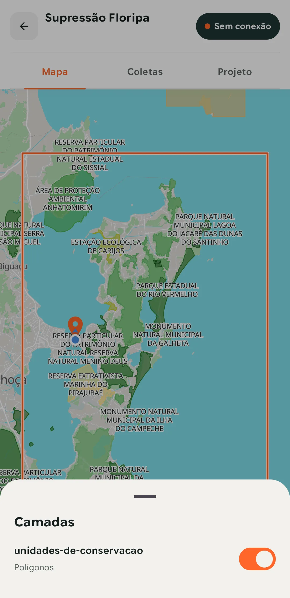

Um mapa de campo só ajuda se quem está no campo entende o que vê. Se a área de preservação e a área de supressão aparecem no mesmo cinza, o técnico precisa tocar em cada polígono para saber onde está. Se os postes aparecem como pontos iguais, ele não sabe quais já foram vistoriados.

O problema costuma começar no escritório. Cada pessoa estiliza a camada no próprio QGIS, o projeto de campo recebe uma cópia sem estilo, e o mapa do celular acaba com uma cara diferente do mapa da reunião.

No TerraNode, o estilo fica junto do dado, no catálogo. Ele é configurado uma vez e vale no painel web, em todos os projetos que usam aquela camada e no app de campo, mesmo sem internet. Este texto percorre o que dá para fazer com esse estilo, de uma camada recém-importada até o mapa no celular.

> O TerraNode está em beta fechado, e o app roda em Android 12 ou mais recente. Se a sua equipe ainda não tem acesso, [entre na lista de espera](https://form.typeform.com/to/ZVQYTFV5).

## O estilo mora no catálogo

Toda camada importada já aparece no mapa com uma aparência padrão. Os pontos têm 4 px com contorno branco, as linhas têm 1,5 px e os polígonos têm 60 % de preenchimento. Dá para conferir se o dado chegou inteiro, mas não dá para trabalhar com isso.

O estilo de verdade é feito na aba **Estilos** do catálogo. Um estilo pertence ao catálogo e pode servir a várias camadas com a mesma geometria. Um estilo de polígonos de uso do solo, por exemplo, vale para os talhões de 2025 e os de 2026. Quando um estilo já está em uso, o TerraNode abre o salvamento em **Salvar como novo**, para que uma mudança feita em uma camada não altere as outras sem você perceber.

Um projeto pode trocar o estilo de uma camada por outro estilo do mesmo catálogo. O normal, porém, é o projeto herdar o estilo do catálogo, e é isso que mantém o mapa igual para todo mundo.

## Vetores, ou o que a cor quer dizer

A primeira escolha é o que a cor representa. Em **Símbolo único**, todas as feições ficam iguais, o que basta para uma camada de referência como limites municipais. Em **Categorizado**, cada valor de um campo ganha uma cor, como o tipo de vegetação ou o status da obra. Em **Graduado**, um campo numérico é cortado em faixas, como a área do lote ou a população do setor censitário.

O editor só oferece os campos que fazem sentido para cada modo. O Graduado pede um campo numérico, e campos de data ou de verdadeiro e falso não entram em nenhuma classificação. Um estilo classifica um campo só.

Nas categorias, o TerraNode lê os valores que existem de fato na camada e monta uma classe para cada um, até 50 valores. Acima de 12 classes ele avisa que as cores começam a se confundir. Esse aviso vale ainda mais no campo, com a tela do celular no sol.

Nas faixas, você escolhe de 3 a 12 classes e um método de corte. **Quantis** põem o mesmo número de feições em cada faixa, **Iguais** dividem o intervalo em partes do mesmo tamanho, e **Naturais** procuram as quebras que os próprios dados sugerem. Enquanto você ajusta, o editor mostra quantas feições caem em cada classe.

Em qualquer classificação, sobra a classe **Outros e nulos**. Ela desenha o que não cai em nenhuma das outras, inclusive feições sem valor. Assim nenhuma feição some do mapa por falta de dado.

## Marcadores, traços e rótulos

Com as cores definidas, vem o desenho de cada geometria. Um ponto pode ser círculo, quadrado ou triângulo, ou um dos 215 ícones da biblioteca, agrupados em temas como água, transporte, saúde e turismo. A busca ignora acentos, então "poco" encontra "Água potável". O ícone é o mesmo para todas as classes do estilo, e o que muda de uma classe para outra é a cor.

Linhas podem ser sólidas, tracejadas ou pontilhadas, com a espessura, a extremidade e a junta que você escolher. É o que separa uma rede projetada de uma rede existente no mesmo mapa. Polígonos têm cor e opacidade de preenchimento e uma linha de contorno própria.

O rótulo escreve no mapa o valor de um campo, como o número da torre ou o nome do talhão. Você escolhe o tamanho, a fonte regular, negrito ou itálico, a cor do texto e um halo, a borda clara em volta das letras que mantém o texto legível sobre uma imagem de satélite. Em linhas, o rótulo pode correr ao longo da linha ou ficar no centro dela.

O zoom fecha a configuração. Cada estilo tem um zoom mínimo e um máximo entre os quais a camada aparece, e o rótulo tem um zoom mínimo próprio. Uma camada com milhares de lotes pode aparecer só de perto, e os rótulos só mais de perto ainda, para que o mapa da cidade inteira não vire uma mancha de texto.

## Rasters pedem outras ferramentas

Uma imagem não tem atributos. Ela tem bandas, e cada pixel tem um valor em cada banda. Por isso o raster tem modos próprios.

A **Rampa** colore uma banda contínua, como elevação ou um índice de vegetação, ao longo de uma escala de cores. **Classes** corta essa banda em 3 a 12 faixas, uma cor para cada. **Valores** dá uma cor a cada valor inteiro, o caso de um mapa de uso do solo, e começa pela paleta gravada no arquivo quando ela existe. A **Composição RGB** põe três bandas nos canais vermelho, verde e azul, cada uma com a própria janela de valores, para montar cor verdadeira ou falsa-cor a partir de uma imagem multiespectral.

Duas opções resolvem os incômodos mais comuns de imagem. Você pode declarar um ou mais valores sem dado e escolher como eles aparecem, para que bordas pretas e lacunas não virem ruído no mapa. E pode esconder os pixels em que uma banda tem um certo valor, como uma máscara de nuvem. Por cima de tudo, há opacidade, brilho, contraste, saturação e a escolha entre um desenho suave ou pixelado.

## Pedir o estilo em português

Montar uma categorização à mão não é difícil, mas são muitos cliques. O **Estilo com IA** troca esses cliques por uma frase. Você escreve o que quer, como "colorir por uso do solo" ou "círculos de tamanho variável por população", e pede **Sugerir estilo**.

O TerraNode procura a coluna que combina com o pedido, lê um resumo dos valores dela e monta o estilo no editor, como um rascunho. Nada é salvo até você clicar em **Salvar estilo**. A partir daí, o rascunho é um estilo como outro qualquer, e você ajusta cores, rótulos e zoom à mão.

Quando o pedido é ambíguo, a resposta pede que você escolha entre as colunas possíveis. Quando o pedido não cabe em um estilo, como classificar por dois campos ao mesmo tempo ou usar um ícone diferente para cada classe, a resposta diz **Não dá para expressar esse pedido.**, em vez de inventar alguma coisa parecida.

A sugestão nunca vê os seus dados inteiros. O modelo recebe o pedido, o tipo de geometria, os nomes e os tipos das colunas e um resumo da coluna escolhida, com até 50 valores e quantas feições têm cada um, ou o mínimo, os quartis e o máximo de um campo numérico. As geometrias e as linhas da tabela não saem da sua organização. O estilo com IA ainda está em fase de testes e atende só camadas vetoriais com tabela de atributos.

## Quem vem do ArcGIS traz o estilo junto

Muitas equipes já têm a simbologia pronta em um portal ArcGIS. Quando você conecta uma camada pela [integração com o ArcGIS](https://docs.terranode.com.br/integracoes/arcgis/), o TerraNode traduz o estilo dela.

Os renderizadores mais comuns têm tradução direta. Símbolo simples, valores únicos de um campo e quebras de classe viram símbolo único, categorias e faixas. Os marcadores simples, os dez tipos de tracejado, a transparência da camada e as escalas de visibilidade, convertidas em zoom, também vêm junto. O rótulo vem quando a primeira classe de rótulos usa um campo só, com tamanho, cor, halo, negrito ou itálico.

O que não tem equivalente fica pelo caminho, e o TerraNode avisa. Um marcador de imagem vira um círculo cinza, uma hachura vira preenchimento sólido, e mapas de calor ou de densidade de pontos não são traduzidos. Os rasters do ArcGIS chegam com os valores originais dos pixels e recebem o estilo no TerraNode.

## No celular, o mesmo desenho sem internet

Tudo isso só vale a pena se chegar ao campo. Quando o TerraNode monta o pacote offline de um projeto, o estilo de cada camada vai junto, com os ícones e as fontes dos rótulos. O app desenha as mesmas regras do painel web, com as cores de cada categoria e de cada faixa, os tracejados, os rótulos com halo e os limites de zoom. Nos rasters, as cores já vêm aplicadas no pacote, iguais às do mapa na web.

Como o estilo faz parte do pacote, mudar um estilo gera uma versão nova do pacote. No celular, o projeto aparece como **Atualização pendente**. O app baixa a versão nova sozinho quando pega Wi-Fi, ou na hora em que alguém toca em **Atualizar Projeto**, e só então a equipe vê a mudança. Quem já saiu para o campo continua com o estilo antigo até voltar ao sinal, então vale fechar os ajustes de estilo antes da saída.

O app ainda não mostra a legenda. O coletor vê o nome de cada camada e liga ou desliga cada uma no mapa. Por enquanto, a legenda fica no painel web.

*Uma camada de polígonos no app, em modo avião. O estilo veio no pacote junto com os dados.*

## Um estilo, muitos mapas

O caminho é sempre o mesmo. O estilo nasce no catálogo, à mão ou a partir de uma frase, e cada projeto que usa a camada herda esse estilo. O pacote offline leva o estilo ao celular, e a equipe vê no campo as mesmas cores, ícones e rótulos que viu na reunião.

Para ver o editor e o estilo com IA em funcionamento, assista à gravação na [página de Catálogos](/recursos/catalogos/). Cada opção está explicada na [documentação de estilos](https://docs.terranode.com.br/catalogos/estilos/). E, se a camada ainda não está no TerraNode, comece por [como levar um Shapefile para o campo](/blog/como-levar-um-shapefile-para-o-campo/).
