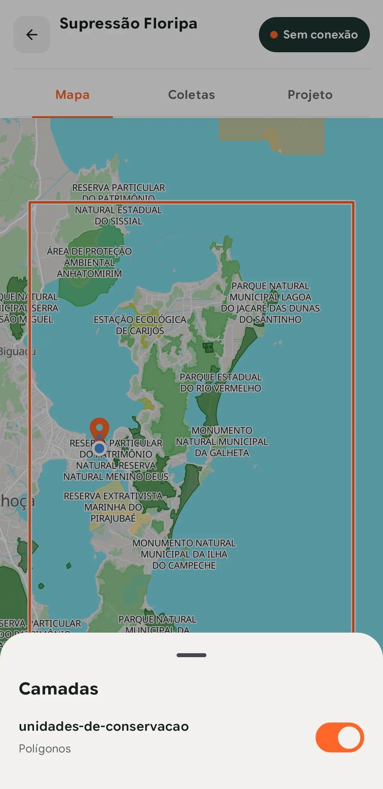

Uma camada de usinas chega ao catálogo como uma coleção de pontos iguais. No meio dela há hidrelétricas e termelétricas, cada uma com nome próprio, mas nada disso aparece no desenho inicial. Quem olha o mapa precisa abrir ponto por ponto para saber o que está vendo.

Vamos acompanhar essa camada até o celular. No catálogo, as usinas ganham cores por tipo, um marcador de barragem e rótulos com seus nomes. O estilo passa para os projetos que usam a camada e segue no pacote offline. Assim, a equipe encontra em campo o mesmo mapa que foi preparado no escritório.

> O TerraNode está em beta fechado, e o app roda em Android 12 ou mais recente. Se a sua equipe ainda não tem acesso, [entre na lista de espera](https://form.typeform.com/to/ZVQYTFV5).

## O desenho começa no catálogo

Assim que a camada de usinas é importada, todos os pontos aparecem com 4 px e contorno branco. A aparência padrão ajuda a conferir se o dado chegou ao lugar certo, mas ainda não distingue uma usina da outra.

O trabalho continua na aba **Estilos** do catálogo. Um estilo pertence ao catálogo e pode ser reaproveitado por outras camadas do mesmo tipo de geometria. O estilo das usinas, por exemplo, pode ser aplicado a outra camada de pontos do mesmo catálogo. A [documentação de estilos](https://docs.terranode.com.br/catalogos/estilos/) explica como esse vínculo funciona. Se o estilo já está em uso, o TerraNode abre o salvamento em **Salvar como novo**, para que um teste não mude outras camadas sem você perceber.

Um projeto pode trocar o estilo de uma camada por outro estilo do mesmo catálogo. O normal, porém, é o projeto herdar o estilo do catálogo, e é isso que mantém o mapa igual para todo mundo.

## Primeiro, a cor precisa dizer alguma coisa

Na camada de usinas, a cor representa o tipo de geração. Em **Categorizado**, cada valor do campo ganha uma cor: azul para hidrelétricas, verde para termelétricas e assim por diante. Se todas devessem aparecer iguais, bastaria usar **Símbolo único**. Para um campo numérico, como potência instalada, o modo **Graduado** dividiria os valores em faixas.

O editor só oferece os campos que fazem sentido para cada modo. O Graduado pede um campo numérico, e campos de data ou de verdadeiro e falso não entram em nenhuma classificação. Cada estilo classifica um único campo.

No modo Categorizado, o TerraNode lê os valores que existem na camada e monta uma classe para cada um, até 50. Acima de 12 classes, ele avisa que as cores começam a se confundir. Na tela de um celular sob o sol, essa diferença fica ainda mais difícil de perceber.

Nas faixas, você escolhe de 3 a 12 classes e um método de corte. **Quantis** põem o mesmo número de feições em cada faixa, **Iguais** dividem o intervalo em partes do mesmo tamanho, e **Naturais** procuram as quebras que os próprios dados sugerem. Enquanto você ajusta, o editor mostra quantas feições caem em cada classe.

Em qualquer classificação, a classe **Outros e nulos** recebe o que não cabe nas demais, inclusive as usinas sem tipo informado. A falta de um valor não faz o ponto desaparecer do mapa.

## Depois vêm o marcador e o nome

Com as cores definidas, falta escolher como cada usina aparece. Um ponto pode ser círculo, quadrado ou triângulo, ou usar um dos 215 ícones da biblioteca. Para essa camada, um marcador de barragem substitui os círculos. O ícone é o mesmo em todas as classes; a cor é que separa hidrelétricas, termelétricas e os demais tipos. A busca da biblioteca ignora acentos, então "poco" encontra "Água potável".

O rótulo usa outro campo da camada. Ao escolher o nome da usina, o mapa passa a identificá-la sem exigir um toque no ponto. Você define o tamanho, a fonte regular, negrito ou itálico, a cor e o halo, que é a borda clara em volta das letras. Sobre uma imagem de satélite, o halo evita que o texto se perca no fundo.

O zoom evita que todos esses nomes cubram o mapa. Cada estilo tem um zoom mínimo e um máximo, e o rótulo tem um zoom mínimo próprio. A camada pode aparecer na visão regional, enquanto os nomes surgem apenas quando a equipe se aproxima da área de trabalho.

Outras geometrias usam controles equivalentes. Linhas podem ser sólidas, tracejadas ou pontilhadas, com espessura, extremidade e junta configuráveis. Polígonos têm cor e opacidade de preenchimento, além de uma linha de contorno própria. Em uma linha, o rótulo pode acompanhar o traçado ou ficar no centro.

## Rasters pedem outras ferramentas

A camada de usinas é vetorial. Uma imagem de satélite usada como fundo segue outra lógica: ela tem bandas, e cada pixel guarda um valor em cada uma. Por isso o raster usa modos próprios.

A **Rampa** colore uma banda contínua, como elevação ou um índice de vegetação, ao longo de uma escala de cores. **Classes** corta essa banda em 3 a 12 faixas, uma cor para cada. **Valores** dá uma cor a cada valor inteiro, o caso de um mapa de uso do solo, e começa pela paleta gravada no arquivo quando ela existe. A **Composição RGB** põe três bandas nos canais vermelho, verde e azul, cada uma com a própria janela de valores, para montar cor verdadeira ou falsa-cor a partir de uma imagem multiespectral.

Duas opções resolvem os incômodos mais comuns de imagem. Você pode declarar um ou mais valores sem dado e escolher como eles aparecem, para que bordas pretas e lacunas não virem ruído no mapa. E pode esconder os pixels em que uma banda tem um certo valor, como uma máscara de nuvem. Por cima de tudo, há opacidade, brilho, contraste, saturação e a escolha entre um desenho suave ou pixelado.

## O mesmo estilo pode começar com uma frase

Também seria possível começar a camada de usinas com o **Estilo com IA**. Em vez de escolher cada controle, você escreve "colorir as usinas por tipo de geração" e pede **Sugerir estilo**.

O TerraNode procura a coluna que combina com o pedido, lê um resumo dos valores e monta um rascunho no editor. Nada é salvo até você clicar em **Salvar estilo**. Antes disso, você ainda pode ajustar manualmente as cores, o marcador, os rótulos e o zoom.

Quando o pedido é ambíguo, a resposta pede que você escolha entre as colunas possíveis. Quando o pedido não cabe em um estilo, como classificar por dois campos ao mesmo tempo ou usar um ícone diferente para cada classe, a resposta diz **Não dá para expressar esse pedido.**, em vez de inventar alguma coisa parecida.

A sugestão não recebe os dados inteiros. O modelo vê o pedido, o tipo de geometria, os nomes e tipos das colunas e um resumo da coluna escolhida. Esse resumo contém até 50 valores e a quantidade de feições em cada um ou, para um campo numérico, o mínimo, os quartis e o máximo. As geometrias e as linhas da tabela não saem da organização. O estilo com IA ainda está em fase de testes e atende apenas camadas vetoriais com tabela de atributos.

## Quem vem do ArcGIS traz o estilo junto

Se a camada de usinas já tiver simbologia em um portal ArcGIS, não é necessário refazê-la do zero. Ao conectar a camada pela [integração com o ArcGIS](https://docs.terranode.com.br/integracoes/arcgis/), o TerraNode tenta traduzir esse estilo.

Os renderizadores mais comuns têm tradução direta: símbolo simples vira **Símbolo único**, valores únicos viram **Categorias** e quebras de classe viram **Faixas**. Os marcadores simples, os dez tipos de tracejado, a transparência da camada e as escalas de visibilidade, convertidas em zoom, também vêm junto. O rótulo vem quando a primeira classe de rótulos usa um campo só, com tamanho, cor, halo, negrito ou itálico.

O que não tem equivalente fica pelo caminho, e o TerraNode avisa. Um marcador de imagem vira um círculo cinza, uma hachura vira preenchimento sólido, e mapas de calor ou de densidade de pontos não são traduzidos. Os rasters do ArcGIS chegam com os valores originais dos pixels e recebem o estilo no TerraNode.

## O mapa chega ao celular

Quando a camada de usinas entra em um projeto, o pacote offline leva as regras de classificação e visibilidade, o marcador de barragem e a tipografia dos rótulos. O app reproduz as categorias, as cores, os nomes com halo e os limites de zoom. Linhas mantêm os tracejados, e os rasters chegam com as cores já aplicadas, iguais às do mapa na web.

Como o estilo faz parte do pacote, mudar um estilo gera uma versão nova do pacote. No celular, o projeto aparece como **Atualização pendente**. O app baixa a versão nova sozinho quando pega Wi-Fi, ou na hora em que alguém toca em **Atualizar Projeto**, e só então a equipe vê a mudança. Quem já saiu para o campo continua com o estilo antigo até voltar ao sinal, então vale fechar os ajustes de estilo antes da saída.

Há uma limitação que precisa entrar na escolha das cores: o app ainda não mostra a legenda. O coletor vê o nome de cada camada e pode ligá-la ou desligá-la, mas a explicação das categorias fica no painel web. No caso das usinas, as cores precisam ser combinadas com a equipe antes da saída.

A imagem abaixo mostra essa passagem para o celular com uma camada de polígonos.

*Uma camada de polígonos no app, em modo avião. O estilo veio no pacote junto com os dados.*

<!-- lista-de-espera -->

## O ponto deixa de ser apenas um ponto

No início, a camada mostrava usinas idênticas e obrigava a equipe a abrir cada ponto. Depois do estilo, a cor indica o tipo de geração, o marcador mostra o tema da camada e o rótulo identifica cada usina. Essa leitura se mantém no painel, nos projetos e no celular sem internet. O trabalho feito no catálogo chega ao campo sem uma segunda configuração.

Para ver o editor e o estilo com IA em funcionamento, assista à gravação na [página de Catálogos](/recursos/catalogos/). Cada opção está explicada na [documentação de estilos](https://docs.terranode.com.br/catalogos/estilos/). Se a camada ainda não está no TerraNode, comece por [como levar um Shapefile para o campo](/blog/como-levar-um-shapefile-para-o-campo/).
